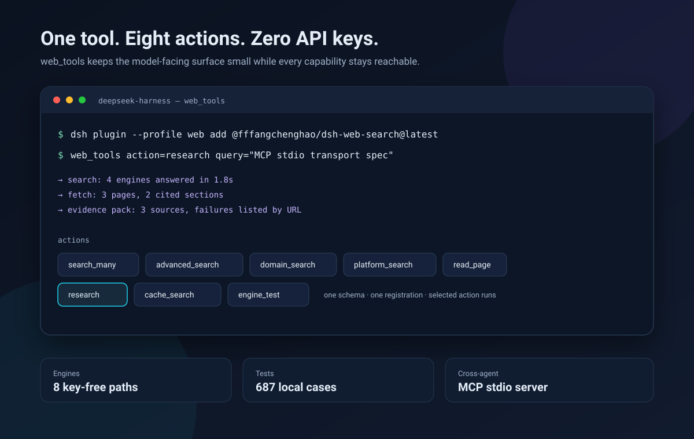

# Quickstart: keyless web search for DSH and other agents

This page gets you from zero to a working `web_tools` call in about two
minutes. It is the English quickstart; the full reference is in
[README.md](../README.md).

## 1. Install in DeepSeek Harness

```sh
dsh plugin --profile defaults add @fffangchenghao/dsh-web-search@latest
```

Use your profile name instead of `defaults` if you run a named profile. Restart
DeepSeek Harness once after installation. No API key is required.

On Windows the command is identical in PowerShell; the plugin has no native
addon and needs only Node 22.18+. If `dsh` is not on `PATH`, use the CLI from
the DSH installation directory or install the npm package from Settings. The
plugin reads the Windows system proxy from Internet Settings automatically;
for a PAC-only proxy, set `proxy` or `DSH_WEB_SEARCH_PROXY` explicitly.

Verify in **Settings → Plugins → Web Search**:

- the engine health section can run a one-probe-per-engine test;
- the latest npm version line appears;
- if a newer npm release exists, a local **Install update** button appears.

## 2. Use it

The model gets one optional tool with eight actions:

```json
{
  "name": "web_tools",
  "arguments": {
    "action": "search_many",
    "queries": ["Node.js 24 release notes", "Node.js 24 breaking changes"]
  }
}
```

Common calls:

| Goal | Action |
| --- | --- |
| One ordinary search | `advanced_search` or `search_many` |
| Package / repo / paper / Q&A | `domain_search` |
| Bilibili / V2EX / Reddit / YouTube / Zhihu / Juejin | `platform_search` |
| Read a long page in chunks | `read_page` |
| Turn searches into a cited pack | `research` |
| Search full texts already fetched | `cache_search` |
| Check which engines answer | `engine_test` |

With the plugin's own skill installed, the model sees when to use each action.
The tool descriptions also carry the boundaries, so the skill is optional.

## 3. Use from Claude Code, Codex or another MCP client

The package ships a dependency-free stdio MCP server:

```sh
npx -y @fffangchenghao/dsh-web-search dsh-web-search-mcp
```

Claude Code:

```sh
claude mcp add dsh-web-search -- npx -y @fffangchenghao/dsh-web-search dsh-web-search-mcp
```

Codex (`~/.codex/config.toml`):

```toml
[mcp_servers.dsh-web-search]
command = "npx"
args = ["-y", "@fffangchenghao/dsh-web-search", "dsh-web-search-mcp"]
```

The server exposes `search`, `fetch`, `research` and `domain_search`. It needs
no DSH context and no API key. See [cross-agent.md](cross-agent.md) for details.

## 4. What to read next

- [Cross-agent MCP setup](cross-agent.md)
- [How ranking works](rrf-ranking.md)
- [30-query comparison method and results](comparison.md) — availability,
  latency and official-source presence against keyless Firecrawl and anonymous
  Exa, with failures listed rather than hidden.
- [Troubleshooting](troubleshooting.md)


