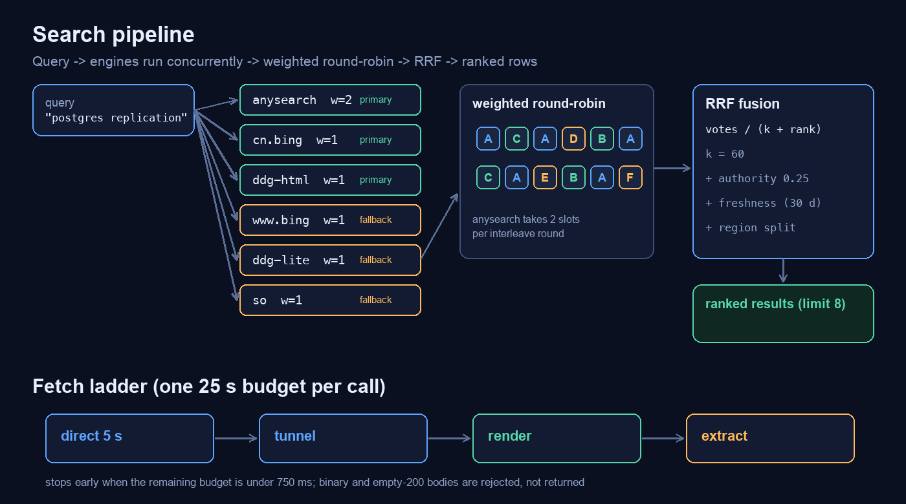
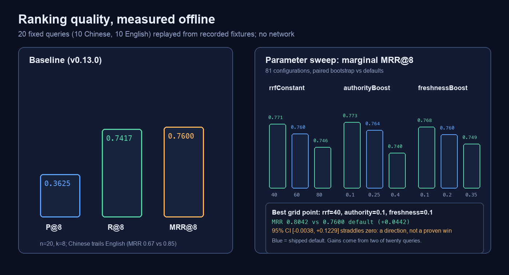

# How the ranking works, and how it is measured

Most "web search plugins" for an agent harness are thin wrappers: call one
engine, return its rows. That is enough to prove the model can reach the web —
and it is why result quality is usually discussed as a feeling.

This plugin treats the eight rows the Host shows the model as the product. That
means the ranking has to be explainable, and the explanation has to survive a
measurement. This page is both.



## The pipeline

1. **Fan out.** Every enabled engine is queried concurrently with its own
   deadline (`timeoutMs`, default 15 s) and its own cooldown state. An engine
   that just failed is skipped instead of being retried on every query.
2. **Normalise.** Each parser returns `{title, url, snippet, position, votes}`
   with the engine's own result order preserved. URLs are canonicalised before
   de-duplication so `?utm_source=…` cannot smuggle the same page in twice.
3. **Interleave.** Engines are merged by weighted round-robin, not by
   concatenation: an engine with weight 2 contributes two slots per round. This
   keeps one verbose engine from filling all eight rows before a second engine
   is even looked at. `anysearch` carries weight 2 because its precision was
   measured highest on both Chinese and English queries.
4. **Fuse.** Each engine's list is scored with reciprocal-rank fusion:

   ```
   vote = 1 / (rrfConstant + position)      # rrfConstant default 60
   score = Σ votes
         + authorityBoost  * isOfficialDomain
         + freshnessBoost  * freshness(parsedDate, freshnessDays)
   ```

   RRF is used instead of score normalisation because engines report scores on
   incomparable scales (or none at all); ranks are the only signal every engine
   provides honestly.
5. **Region policy.** A CJK query leads with the engines that answer Chinese
   sources (`cn.bing`, `anysearch`); an ASCII query leads with the global set
   (`ddg-html`, `www.bing`, `anysearch`). The other region's engines still
   contribute, so a Chinese query can still surface an English original.
6. **Cut.** The fused list is truncated to `limit` (default 8, clamped 1–20).
   Only the rows that survive are returned; the model never sees the raw
   per-engine lists.

## Why these exact knobs

Each knob exists because a specific failure was observed:

| knob | default | what it prevents |
|---|---|---|
| `rrfConstant` | 60 | a single engine's first result dominating the fusion |
| `authorityBoost` | 0.25 | documentation on `kubernetes.io` losing to a SEO farm |
| `freshnessBoost` / `freshnessDays` | 0.2 / 30 | last year's release notes outranking this month's |
| region split | on | English pages burying the Chinese documentation a Chinese query asked for |
| engine weight | `anysearch` = 2 | a precise engine receiving the same airtime as a noisy one |

## How it is measured

`bench/` holds 20 fixed queries — 10 Chinese, 10 English, five each in docs /
release / package / news — each annotated with 1–3 expected domains. Encoding
the expectation in domains rather than exact URLs is deliberate: result titles
and snippets change constantly, domains are the part the ranking is supposed to
get right.

```
node scripts/bench.mjs            # offline: replay recorded fixtures, no network
node scripts/bench.mjs --record   # refresh fixtures from the live engines
node scripts/bench.mjs --json     # machine-readable output for version diffs
```

The bench reports precision@8, recall@8 and MRR@8 overall, per language, per
category and per engine, plus the worst query. Offline replay makes the number
comparable across commits; `--record` is the only mode that touches the network.



Baseline (v0.13.0, 20 queries, k=8):

| metric | overall | Chinese | English |
|---|---:|---:|---:|
| P@8 | 0.3625 | 0.3250 | 0.4000 |
| R@8 | 0.7417 | 0.7333 | 0.7500 |
| MRR@8 | 0.7600 | 0.6700 | 0.8500 |

One query (`zh-linux-612`) returns zero expected domains; that is visible in
the output on purpose rather than averaged away.

## Parameter sweep

`scripts/sweep.mjs` runs an 81-configuration grid over the same fixtures and
reports marginal means plus a paired bootstrap against the shipped defaults:

```
node scripts/sweep.mjs           # full grid (~2 min, offline)
node scripts/sweep.mjs --quick   # 27-config subset
node scripts/sweep.mjs --json    # includes the per-config CI data
```

Marginal MRR@8 (all other knobs at defaults):

| `rrfConstant` | MRR@8 | `authorityBoost` | MRR@8 | `freshnessBoost` | MRR@8 |
|---:|---:|---:|---:|---:|---:|
| 40 | 0.7712 | 0.1 | 0.7733 | 0.1 | 0.7681 |
| **60** | **0.7604** | **0.25** | **0.7645** | **0.2** | **0.7598** |
| 80 | 0.7456 | 0.4 | 0.7395 | 0.35 | 0.7494 |

The best grid point (`rrf=40, authority=0.1, freshness=0.1`) measures MRR 0.8042
against the default 0.7600 — a gain of +0.0442 — but its 95 % paired-bootstrap
interval is `[-0.0038, +0.1229]`, which straddles zero. The entire gain comes
from two of twenty queries. That is a promising direction, not a proven win, so
the defaults did not change. The sweep is kept as a script precisely so this
question can be re-asked after the query set grows.

The same discipline applied to engine weights: dropping `cn.bing` to weight 0.25
and raising `ddg-html` to 2 measured MRR 0.7708 with a lower bound of 0.0000 —
inside noise, so it was not adopted.

## Known limits

- **Relative Chinese time words.** A query like "上周发布的那版" carries its time
  constraint in the words themselves. The freshness boost can only act on dates
  it can parse out of snippets; when an engine's snippet omits the date, the
  ranker cannot recover it. This is documented rather than papered over.
- **Snippet quality bounds ranking.** If no engine returns the expected domain
  in its top 20, fusion cannot invent it; `bench/` makes that visible per query.
- **The fixture set is 20 queries.** Small enough to run on every change, too
  small to certify a general ranking. The per-query output is kept so the number
  cannot hide a single catastrophic query.
